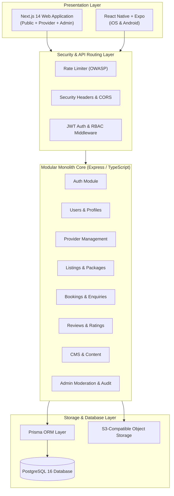

# System Architecture Documentation
## Multi-Provider Marketplace Platform — Phase 1 MVP

---

### 1. Architectural Philosophy (Modular Monolith)
In direct adherence to **Section 2 of the Confidential Developer Brief**, Phase 1 is engineered as a **Modular Monolith** rather than fragmented microservices. This eliminates distributed transaction complexities, network hops, and operational overhead while ensuring clean logical boundaries between bounded contexts.

Every logical module communicates through typed internal interfaces and centralized domain services, ensuring that any module (such as Search or Bookings) can be detached into an autonomous microservice in Phase 2 or Phase 3 should commercial transaction scale demand it.

---

### 2. Presentation Layer Components

#### A. Public Marketplace Website
- **Framework**: Next.js 14 + React 18 + Tailwind CSS.
- **Responsibilities**:
  - SEO-optimized Server-Side Rendering (SSR) & Static Generation (SSG).
  - Search discovery engine with live multi-criteria filtering (Destination, Category, Price, Rating, Verification).
  - Dedicated package details with day-by-day itineraries, inclusions vs exclusions, and interactive booking modal.
  - Public provider storefronts displaying official verification badges, operating history, and reviews.
  - Informational CMS pages (About, FAQs accordion, Terms & Conditions, Privacy Policy, Contact).

#### B. Customer Mobile Application
- **Framework**: React Native + Expo + TypeScript.
- **Responsibilities**:
  - Native iOS & Android cross-platform experience.
  - Bottom tab navigation: Explore, Bookings Tracker, Customer Profile.
  - Interactive booking modal with live pricing calculations and instant status updates.

#### C. Provider Dashboard
- **Web-Based Management Hub**:
  - Verification application submission (trade licenses, tax ID NTN).
  - Listing creation wizard with package pricing tiers, day-by-day itinerary builder, and inclusions/exclusions.
  - Request management: Accept, Reject with reason, Mark Completed.
  - In-platform live communication thread with customers.

#### D. Admin Moderation & Control Panel
- **Operational Management Console**:
  - Provider verification queue: manual document audit, Approve or Reject.
  - Listing moderation queue: publish live or reject with corrective feedback.
  - Master bookings view with dispute tracking and administrative status override.
  - Review moderation: filter flagged/reported reviews, hide inappropriate content.
  - Immutable audit logs capturing actor, action, timestamp, and metadata.

---

### 3. Domain Modules & Logical Boundaries

| Module | Core Responsibilities | Key Entities Managed |
| :--- | :--- | :--- |
| **Auth & Security** | JWT issuing, bcrypt hashing, RBAC enforcement, session validation | `User`, `Permission` |
| **Users** | Profile updates, favorite listings, in-app notifications, support | `User`, `Favourite`, `Notification` |
| **Providers** | Onboarding, verification document intake, profile presence, stats | `Provider`, `ProviderStaff` |
| **Listings & Catalog** | Multi-package offerings, day-by-day itineraries, inclusions, media | `Listing`, `Package`, `ItineraryItem`, `Media` |
| **Taxonomy** | Geographic destinations, activity categories, slugs, SEO tags | `Destination`, `Category` |
| **Search Engine** | Text search, multi-attribute filtering, sorting, pagination | PostgreSQL indexed queries |
| **Bookings & Requests** | Customer enquiry flow, provider workflow, state transitions | `Booking`, `BookingItem`, `Transaction` |
| **Messaging** | Direct customer-provider request messaging threads | `Message` |
| **Reviews & Ratings** | Post-transaction review submission, moderation, score re-calculation | `Review`, `Rating` |
| **Discounts & Offers** | Promotional campaigns, discount percentage, date range validation | `Discount`, `Coupon` |
| **Administration** | Platform KPIs, user suspension, moderation queues, audit trail | `AuditLog`, `CMSBanner` |

---

### 4. Non-Functional Requirements & Scalability Path

1. **Database Indexing**: All foreign keys (`providerId`, `destinationId`, `categoryId`, `userId`, `listingId`) and high-cardinality search columns (`status`, `basePrice`, `rating`, `email`) have explicit database indexes.
2. **Horizontal Scaling**: Because the backend is stateless (using signed JWTs), multiple container instances can be run behind an Nginx or AWS Application Load Balancer without session synchronization issues.
3. **Dedicated Search Transition**: In Phase 2/3, the database query layer in `src/modules/listings/listings.controller.ts` can be redirected to OpenSearch, Algolia, or Elasticsearch without altering the frontend or mobile contracts.
