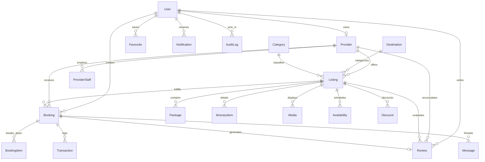

# Database Schema & Entity-Relationship Documentation
## Multi-Provider Marketplace — Section 23 Compliance

---

### 1. Database Architecture Overview
The database is implemented using **Prisma ORM** with full relational integrity, foreign key constraints, explicit indexing, and timestamps.

- **Engine**: PostgreSQL 16 (production/staging) / SQLite (zero-config local runtime).
- **Migration Engine**: `prisma db push` / `prisma migrate dev`.
- **Character Set / Collation**: UTF-8.

---

### 2. Comprehensive Entity Catalogue (23 Required Entities)

#### 1. `User`
Stores system accounts across all user roles.
- `id` (UUID, Primary Key)
- `email` (VARCHAR, Unique, Indexed)
- `passwordHash` (VARCHAR, bcrypt encrypted)
- `firstName`, `lastName` (VARCHAR)
- `phone` (VARCHAR, Optional)
- `avatarUrl` (VARCHAR, Optional)
- `role` (ENUM: `SUPER_ADMIN`, `OPERATIONS_ADMIN`, `CONTENT_MANAGER`, `SUPPORT`, `PROVIDER`, `CUSTOMER`, Indexed)
- `isActive` (BOOLEAN, default: true)
- `isEmailVerified` (BOOLEAN, default: true)
- `createdAt`, `updatedAt` (TIMESTAMP)

#### 2. `Role` & `Permission`
Role-Based Access Control matrix enforced on the backend.
- `id` (UUID, Primary Key)
- `role` (VARCHAR)
- `resource` (VARCHAR, e.g. "listings", "providers", "bookings", "cms", "users")
- `action` (VARCHAR, e.g. "create", "read", "update", "delete", "moderate", "all")

#### 3. `Provider`
Service provider legal business entity.
- `id` (UUID, Primary Key)
- `userId` (UUID, Foreign Key -> `User.id`, Unique)
- `businessName` (VARCHAR)
- `tradeLicenseNo` (VARCHAR, Tourism/Marine permit)
- `taxId` (VARCHAR, FBR NTN)
- `phone`, `email`, `address`, `city`, `country` (VARCHAR)
- `bio` (TEXT)
- `logoUrl`, `bannerUrl` (VARCHAR)
- `verificationStatus` (ENUM: `PENDING`, `APPROVED`, `REJECTED`, `SUSPENDED`, Indexed)
- `verificationNotes` (TEXT, Auditor feedback)
- `verificationDocs` (TEXT, Cloud document links)
- `rating` (FLOAT, default: 5.0)
- `reviewCount` (INT, default: 0)
- `isActive` (BOOLEAN, default: true)

#### 4. `ProviderStaff`
Authorized staff accounts operating on behalf of a Provider.
- `id` (UUID, Primary Key)
- `providerId` (UUID, Foreign Key -> `Provider.id`)
- `userId` (UUID, Foreign Key -> `User.id`)
- `role` (VARCHAR: `OWNER`, `MANAGER`, `AGENT`)
- `permissions` (TEXT, JSON representation)

#### 5. `Destination`
Geographic search taxonomy.
- `id` (UUID, Primary Key)
- `name` (VARCHAR, Unique)
- `slug` (VARCHAR, Unique, Indexed)
- `country`, `region` (VARCHAR)
- `description` (TEXT)
- `imageUrl` (VARCHAR)
- `isFeatured` (BOOLEAN, Indexed)

#### 6. `Category`
Activity and expedition classification.
- `id` (UUID, Primary Key)
- `name` (VARCHAR, Unique)
- `slug` (VARCHAR, Unique, Indexed)
- `description` (TEXT)
- `icon` (VARCHAR, Lucide icon identifier)
- `imageUrl` (VARCHAR)
- `isFeatured` (BOOLEAN)

#### 7. `Listing`
Core marketplace package offering.
- `id` (UUID, Primary Key)
- `providerId` (UUID, Foreign Key -> `Provider.id`, Indexed)
- `destinationId` (UUID, Foreign Key -> `Destination.id`, Indexed)
- `categoryId` (UUID, Foreign Key -> `Category.id`, Indexed)
- `title` (VARCHAR)
- `slug` (VARCHAR, Unique, Indexed)
- `shortDescription` (TEXT)
- `fullDescription` (TEXT)
- `status` (ENUM: `DRAFT`, `PENDING_APPROVAL`, `PUBLISHED`, `REJECTED`, `SUSPENDED`, `ARCHIVED`, Indexed)
- `rejectionReason` (TEXT, Optional)
- `basePrice` (FLOAT, Indexed)
- `currency` (VARCHAR, default: "PKR")
- `durationDays` (INT, default: 1)
- `maxGuests` (INT, default: 10)
- `meetingPoint` (VARCHAR)
- `inclusions` (TEXT, JSON array of included items)
- `exclusions` (TEXT, JSON array of excluded items)
- `highlights` (TEXT, JSON array of key attractions)
- `cancellationPolicy` (TEXT)
- `termsAndConditions` (TEXT)
- `isFeatured` (BOOLEAN)
- `featuredPriority` (INT, default: 0)
- `rating` (FLOAT, default: 5.0, Indexed)
- `reviewCount` (INT, default: 0)

#### 8. `Package`
Specific tier options for a listing (e.g. Standard vs Deluxe Private Suite).
- `id` (UUID, Primary Key)
- `listingId` (UUID, Foreign Key -> `Listing.id`)
- `name` (VARCHAR)
- `description` (TEXT)
- `price` (FLOAT)
- `discountedPrice` (FLOAT, Optional)
- `minGuests`, `maxGuests`, `durationDays` (INT)

#### 9. `ItineraryItem`
Day-by-day expedition progression.
- `id` (UUID, Primary Key)
- `listingId` (UUID, Foreign Key -> `Listing.id`)
- `dayNumber` (INT, Ordered)
- `title`, `description` (TEXT)
- `mealsIncluded`, `accommodation` (VARCHAR)

#### 10. `Media`
Gallery assets associated with listings.
- `id` (UUID, Primary Key)
- `listingId` (UUID, Foreign Key -> `Listing.id`)
- `url` (VARCHAR)
- `altText` (VARCHAR)
- `isCover` (BOOLEAN, default: false)
- `sortOrder` (INT, default: 0)

#### 11. `Availability`
Calendar schedule and slot capacities.
- `id` (UUID, Primary Key)
- `listingId` (UUID, Foreign Key -> `Listing.id`)
- `date` (VARCHAR, Format: YYYY-MM-DD)
- `availableSlots` (INT, default: 10)
- `priceOverride` (FLOAT, Optional)
- `isBlocked` (BOOLEAN, default: false)
- *Constraint: Unique(`listingId`, `date`)*

#### 12. `Booking`
Customer booking request and transaction workflow.
- `id` (UUID, Primary Key)
- `bookingReference` (VARCHAR, Unique, e.g. "BK-2026-104921")
- `userId` (UUID, Foreign Key -> `User.id`, Indexed)
- `providerId` (UUID, Foreign Key -> `Provider.id`, Indexed)
- `listingId` (UUID, Foreign Key -> `Listing.id`)
- `packageId` (UUID, Optional Foreign Key -> `Package.id`)
- `startDate`, `endDate` (VARCHAR, YYYY-MM-DD)
- `guestsCount` (INT, default: 1)
- `unitPrice`, `totalPrice`, `discountAmount`, `finalPrice` (FLOAT)
- `currency` (VARCHAR, default: "PKR")
- `status` (ENUM: `PENDING`, `CONFIRMED`, `REJECTED`, `CANCELLED`, `COMPLETED`, Indexed)
- `customerNotes`, `providerNotes`, `rejectionReason`, `cancellationReason` (TEXT)

#### 13. `BookingItem`
Line-item financial breakdown for a booking.
- `id` (UUID, Primary Key)
- `bookingId` (UUID, Foreign Key -> `Booking.id`)
- `description` (VARCHAR)
- `quantity` (INT)
- `unitPrice`, `totalPrice` (FLOAT)

#### 14. `Transaction`
Financial audit records of payments.
- `id` (UUID, Primary Key)
- `bookingId` (UUID, Foreign Key -> `Booking.id`)
- `transactionReference` (VARCHAR, Unique)
- `amount` (FLOAT)
- `currency` (VARCHAR, default: "PKR")
- `status` (ENUM: `PENDING`, `COMPLETED`, `FAILED`, `REFUNDED`)
- `paymentMethod` (VARCHAR, e.g. `BANK_TRANSFER`, `JAZZCASH`, `EASYPAISA`)

#### 15. `Review` & `Rating`
Verified customer evaluations after trip completion.
- `id` (UUID, Primary Key)
- `bookingId` (UUID, Foreign Key -> `Booking.id`, Unique)
- `userId` (UUID, Foreign Key -> `User.id`)
- `providerId` (UUID, Foreign Key -> `Provider.id`, Indexed)
- `listingId` (UUID, Foreign Key -> `Listing.id`, Indexed)
- `rating` (INT, 1 to 5)
- `title`, `comment` (TEXT)
- `status` (ENUM: `PUBLISHED`, `HIDDEN`, `REPORTED`, Indexed)
- `reportReason` (TEXT, Optional)
- `providerResponse` (TEXT, Optional operator reply)

#### 16. `Discount` & `Coupon`
Promotional campaign engines.
- `id` (UUID, Primary Key)
- `listingId` (UUID, Foreign Key -> `Listing.id`, Indexed)
- `title`, `code` (VARCHAR)
- `percentage`, `fixedAmount` (FLOAT)
- `startDate`, `endDate` (VARCHAR)
- `isActive` (BOOLEAN, Indexed)

#### 17. `Favourite`
Customer saved offerings.
- `id` (UUID, Primary Key)
- `userId` (UUID, Foreign Key -> `User.id`)
- `listingId` (UUID, Foreign Key -> `Listing.id`)
- *Constraint: Unique(`userId`, `listingId`)*

#### 18. `Notification`
In-app and dispatchable alert feed.
- `id` (UUID, Primary Key)
- `userId` (UUID, Foreign Key -> `User.id`, Indexed)
- `title`, `message` (TEXT)
- `type` (ENUM: `INFO`, `BOOKING_UPDATE`, `VERIFICATION`, `REVIEW`, `SYSTEM`)
- `read` (BOOLEAN, default: false, Indexed)
- `link` (VARCHAR)

#### 19. `Message`
Direct request messaging thread between customer and provider.
- `id` (UUID, Primary Key)
- `bookingId` (UUID, Foreign Key -> `Booking.id`, Indexed)
- `senderId` (UUID, Foreign Key -> `User.id`)
- `receiverId` (UUID, Foreign Key -> `User.id`)
- `message` (TEXT)
- `isRead` (BOOLEAN, default: false)

#### 20. `SupportTicket`
Customer service inquiry logging.
- `id` (UUID, Primary Key)
- `userId` (UUID, Foreign Key -> `User.id`)
- `subject`, `description` (TEXT)
- `priority` (ENUM: `LOW`, `NORMAL`, `HIGH`, `URGENT`)
- `status` (ENUM: `OPEN`, `IN_PROGRESS`, `RESOLVED`, `CLOSED`, Indexed)

#### 21. `AuditLog`
Immutable administrative event log.
- `id` (UUID, Primary Key)
- `actorId` (UUID, Foreign Key -> `User.id`, Optional)
- `actorRole` (VARCHAR)
- `action` (VARCHAR, Indexed, e.g. `PROVIDER_APPROVED`, `LISTING_MODERATED`)
- `entityType`, `entityId` (VARCHAR, Indexed)
- `metadata` (TEXT, JSON string before/after)
- `ipAddress` (VARCHAR, Optional)

#### 22. `CMSBanner`
Content Management System banners and announcements.
- `id` (UUID, Primary Key)
- `title`, `subtitle`, `tag` (VARCHAR)
- `imageUrl`, `linkUrl` (VARCHAR)
- `position` (VARCHAR: `HOMEPAGE_HERO`, `PROMO_SECTION`, `SIDEBAR`)
- `isActive` (BOOLEAN, default: true)
- `sortOrder` (INT, default: 0)
